# Informe Mensal — REAP mês a mês por sócio

**Versão:** v1.8.4 (2026-11-05)  
**Download do EXE:** https://github.com/ANmoLOCK/sinapesc-casanova-reap/releases/download/v1.8.4/SinapescREAP-Windows-v1.8.4.zip  
**Página da release:** https://github.com/ANmoLOCK/sinapesc-casanova-reap/releases/tag/v1.8.4  
**Origem do cérebro:** pacote `reap-informe-mensal-v1.8.0.zip` (`cerebro_reformulacao.py` v4), refatorado na v1.8.1 para plano probabilístico por sócio (`v5-plano`)

---

## 1. O que é

Módulo novo do SINAPESC que gera o **REAP do Informe Mensal** de cada sócio, **um mês por vez**, e salva o resultado **dentro da planilha do REAP**. Toda geração e alteração fica registrada na aba **Auditoria** do módulo.

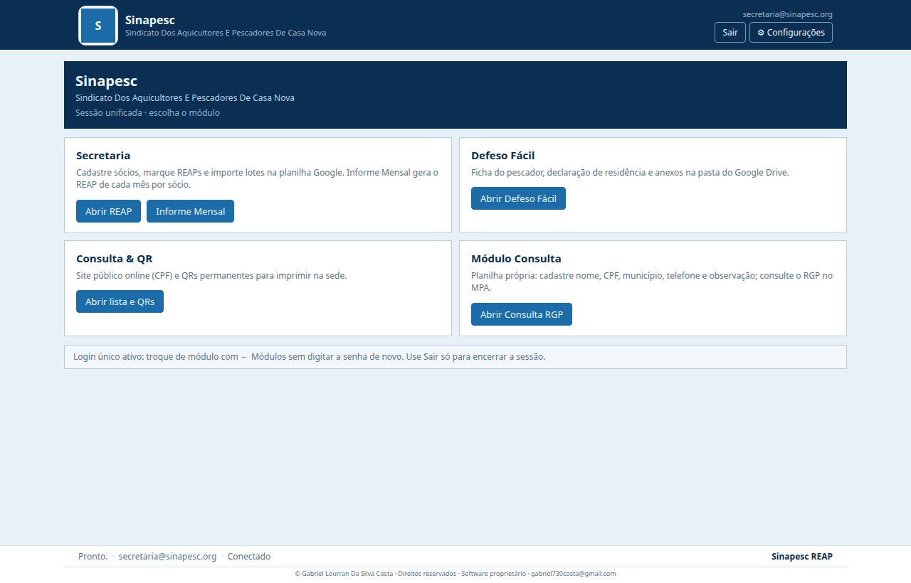

## 2. Como abrir

1. Abra o EXE e entre com o **login único**.
2. No hub de módulos, card **Secretaria**, clique em **Informe Mensal** (ao lado de **Abrir REAP**).
3. Para voltar ao hub use **← Módulos** (não pede senha de novo).

## 3. Tela de sócios

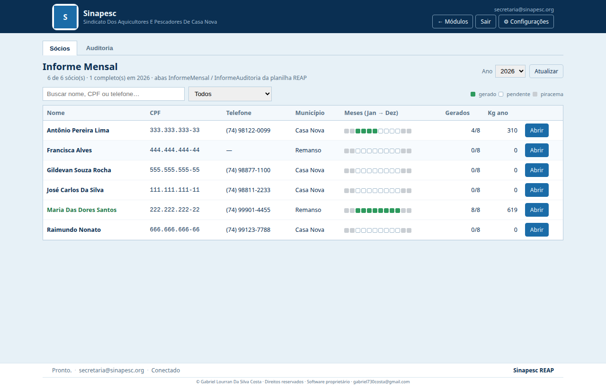

- Os sócios vêm da aba **Pessoas** da planilha REAP: **nome, CPF, telefone e município**.
- **Ano:** escolha o ano do informe (padrão: ano atual).
- **Busca:** por nome, CPF ou telefone (com ou sem pontuação).
- **Filtro:** Todos · Com meses pendentes · Nenhum mês gerado · Completos (Mar–Out) · Com avisos do cérebro · **Com padrão igual a outro sócio**.
- **Padrões iguais:** acima da tabela aparece uma faixa vermelha quando dois ou mais sócios têm o mesmo plano de quantidades, os mesmos kg por mês ou um mês idêntico (mesmas espécies e kg). Clique para ver quais sócios. Na lista eles ganham o selo vermelho **=**. Se não houver nenhum, a faixa fica verde.

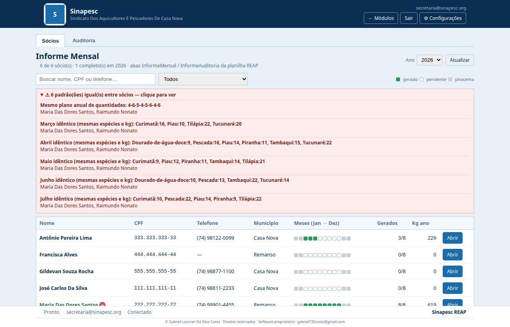
- **Meses (Jan → Dez):** quadradinho verde = gerado, branco = pendente, cinza = piracema.
- **Gerados:** quantos dos 8 meses de pesca já têm REAP. **Kg ano:** soma dos kg já gerados.
- Clique na linha (ou em **Abrir**) para abrir a caixa do sócio.
- Botão **Peixes do cérebro**: configuração exclusiva desta aba. Marque quais dos 8 peixes o cérebro pode usar ao Gerar REAP. A seleção é **universal** (vale para todos os sócios), fica em `config.json` e exige no mínimo 4 peixes. Com menos de 8, o mês de 8 espécies não entra no plano.

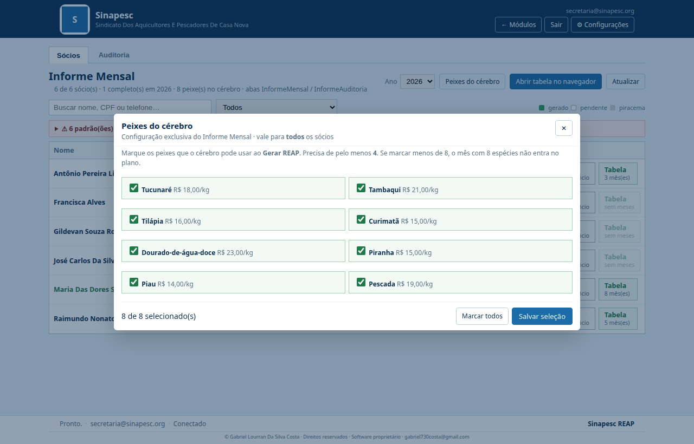

- Em cada linha, ao lado de **Abrir**, o card **Tabela** abre no navegador um HTML **só daquele sócio**, com **apenas os meses preenchidos** (tabela resumida + detalhe das espécies). Se ainda não houver mês gerado, o card fica desabilitado.

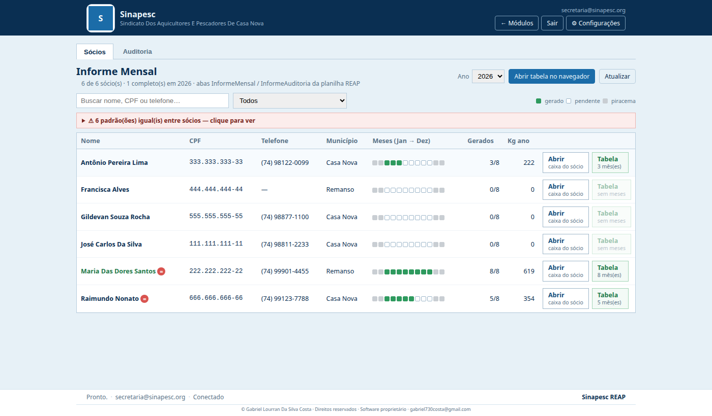

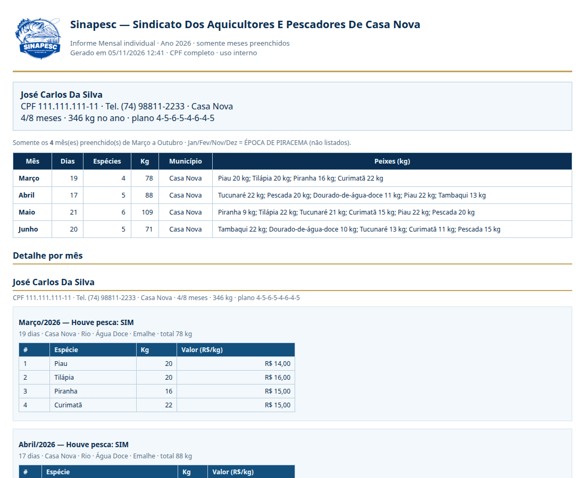

- **Abrir tabela no navegador:** gera um HTML com **uma linha por sócio** e as células dos 12 meses (piracema em cinza; meses gerados em verde com espécies · kg · dias; pendentes com —). Embaixo, o **detalhe** de cada sócio com tabela de espécies dos meses preenchidos. O arquivo abre numa aba do navegador (Imprimir → Salvar como PDF) e fica na pasta de relatórios do Sinapesc. A ação entra na Auditoria.

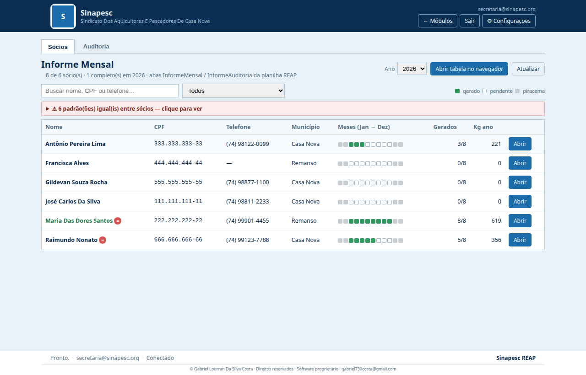

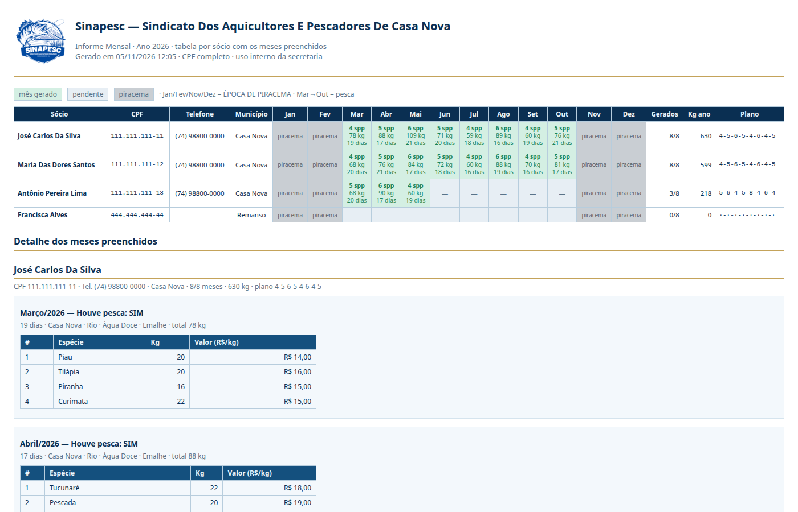

## 4. Caixa do sócio (os 12 meses)

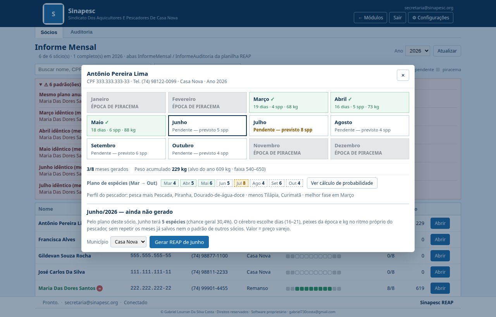

| Mês | Situação |
|-----|----------|
| Janeiro | **ÉPOCA DE PIRACEMA** (cinza, não clica) |
| Fevereiro | **ÉPOCA DE PIRACEMA** (cinza, não clica) |
| Março → Outubro | Liberados: *Pendente — gerar REAP* ou ✓ com dias · espécies · kg |
| Novembro | **ÉPOCA DE PIRACEMA** (cinza, não clica) |
| Dezembro | **ÉPOCA DE PIRACEMA** (cinza, não clica) |

Abaixo dos meses aparece:

- o resumo do ano: meses gerados (x/8), peso acumulado, alvo do ano do sócio e faixa 540–650 kg;
- o **Plano de espécies (Mar → Out)**: quantas espécies cada mês terá. Meses já gerados ficam em verde, previstos em tracejado e o mês de **8 espécies** (quando o sócio tem) em laranja. Os meses pendentes mostram *Pendente — previsto N spp*;
- o **Perfil do pescador**: as espécies que ele mais pesca e menos pesca, e a fase do ano em que produz mais;
- o botão **Ver cálculo de probabilidade**, que abre a tabela com a chance de cada quantidade por mês (seção 5.5);
- um aviso vermelho se o sócio tiver padrão igual ao de outro sócio, e um aviso amarelo se alguma regra do ano estiver fora.

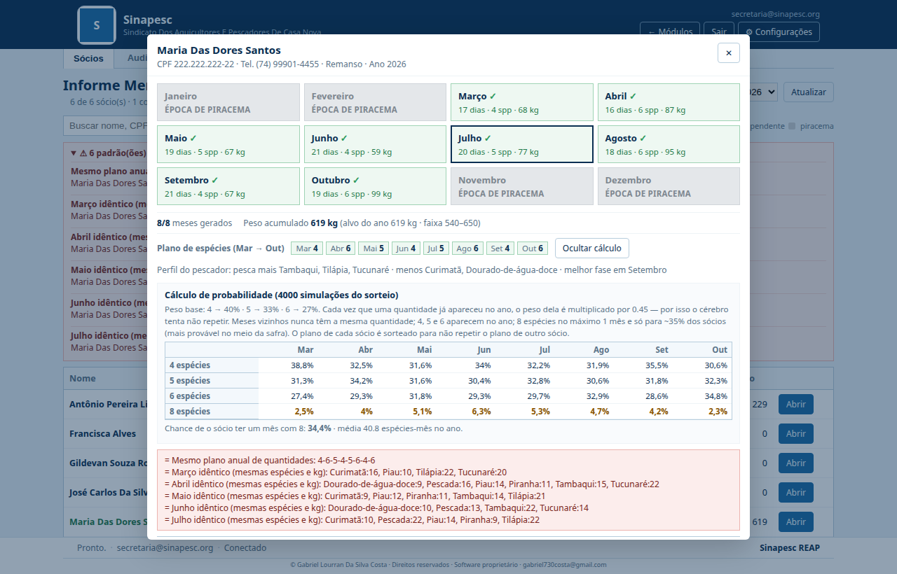

### 4.1 Gerar o REAP de um mês

1. Clique no mês pendente.
2. Confira o **Município** (Casa Nova ou Remanso; vem do cadastro do sócio).
3. Clique **Gerar REAP de <mês>**.

O cérebro gera e **já salva na planilha** (aba `InformeMensal`).

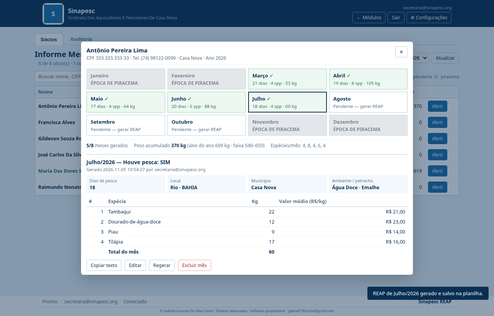

O detalhe mostra: houve pesca SIM, dias de pesca, local (Rio · BAHIA), município, ambiente (Água Doce), petrecho (Emalhe), espécies na ordem, kg e valor médio (R$/kg), total do mês, quem gerou e quando.

### 4.2 Botões do mês gerado

| Botão | O que faz |
|-------|-----------|
| **Copiar texto** | Copia o REAP em texto para conferir/colar no Informe Mensal do gov.br |
| **Editar** | Ajuste manual de dias, município, espécies, kg e ordem (↑) |
| **Regerar** | Pede confirmação e gera um novo REAP para o mês, sem repetir os outros meses |
| **Excluir mês** | Pede confirmação e remove a linha do mês da planilha |

### 4.3 Editar

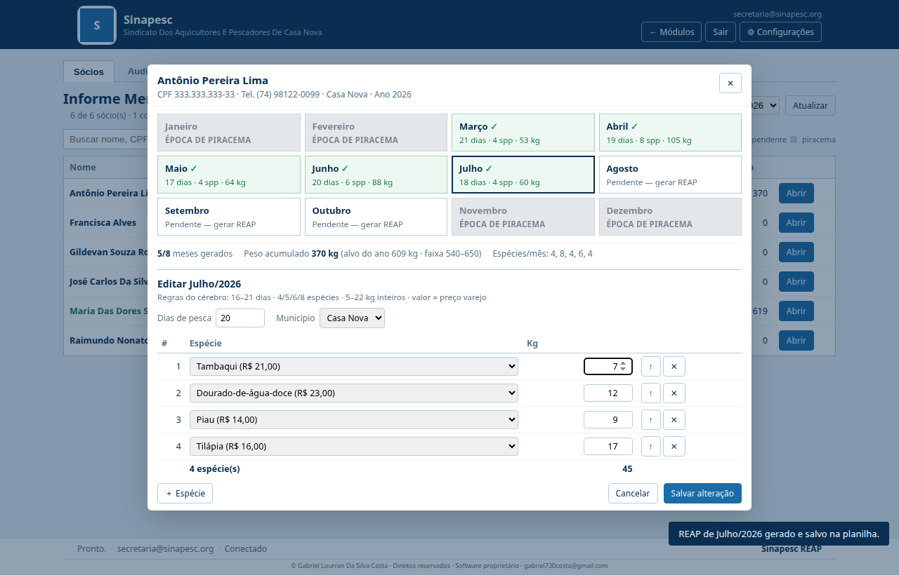

O sistema **não salva** se a edição quebrar uma regra do mês:

- dias entre **16 e 21**;
- **4, 5, 6 ou 8** espécies (a quantidade pode sair do plano; se ficar igual à do mês vizinho ou passar do limite do ano, aparece aviso);
- só peixes do catálogo, sem repetir no mesmo mês;
- kg **inteiro entre 5 e 22**;
- os kg não podem ser todos iguais;
- o conjunto espécies + kg não pode ser igual ao de outro mês do mesmo sócio.

O **valor** é sempre o preço varejo da espécie (não se digita).

## 5. Regras do cérebro

### 5.1 Calendário

| Mês | Pesca |
|-----|-------|
| Jan / Fev / Nov / Dez | NÃO — época de piracema |
| Mar → Out | SIM nos 8 meses |

### 5.2 Preços varejo (VALOR no site = preço, não multiplica por kg)

| Peixe | R$/kg |
|-------|------:|
| Tucunaré | 18 |
| Tambaqui | 21 |
| Tilápia | 16 |
| Curimatã | 15 |
| Dourado-de-água-doce | 23 |
| Piranha | 15 |
| Piau | 14 |
| Pescada | 19 |

### 5.3 Espécies, valores e kg mudam por mês (atividade sazonal)

Cada mês favorece peixes diferentes (mais kg e mais chance de entrar na lista):

| Mês | Mais ativos | Menos ativos |
|-----|-------------|--------------|
| Março | Curimatã, Tilápia, Piau | Tambaqui, Dourado |
| Abril | Curimatã, Tilápia, Piau, Tucunaré | Tambaqui, Dourado |
| Maio | Tilápia, Piau, Curimatã, Pescada | Dourado |
| Junho | Tambaqui, Tilápia, Pescada | Piranha |
| Julho | Tambaqui, Pescada, Tilápia | Piranha |
| Agosto | Tambaqui, Pescada, Tilápia | Curimatã, Piranha |
| Setembro | Tucunaré, Piranha, Tilápia | Dourado |
| Outubro | Tucunaré, Piranha, Tilápia, Piau | Dourado |

### 5.4 Nunca repetir (intercalação)

Como o operador gera **um mês por vez**, cada mês novo é calculado olhando os meses que o sócio já tem salvos:

- **Quantidade de espécies:** segue o **plano anual do sócio** (seção 5.5): meses vizinhos nunca com a mesma quantidade, 4, 5 e 6 aparecem no ano, no máximo 3 meses de cada e **no máximo 1 mês com 8**, que só alguns sócios têm.
- **Conjunto espécies + kg:** nunca igual ao de outro mês do ano.
- **Posição dos peixes:** a ordem nunca se repete, e o primeiro peixe é diferente do primeiro do mês vizinho.
- **Dias:** diferentes dos do mês vizinho e, quando possível, de todos os outros meses.
- **Kg humanizados por pessoa:** inteiros com o viés da época **e** do perfil do pescador. Cada sócio tem uma preferência própria por espécie (de 0,80 a 1,25) e um ritmo de produção ao longo do ano, com o pico num mês só dele. Assim dois sócios não pescam igual, mesmo com a mesma quantidade de espécies.
- **Peso anual:** cada sócio tem um **alvo próprio** entre **540 e 650 kg** (fixo pelo CPF + ano). Os meses dividem esse alvo e o último mês gerado fecha a conta.
- **Entre sócios:** a assinatura do mês é comparada com a de todos os sócios; nenhum mês sai idêntico ao de outro pescador.

A ordem de geração não importa: o operador pode gerar Junho antes de Março.

### 5.5 Plano de quantidades e cálculo de probabilidade

Antes, todos os sócios caíam em sequências parecidas (ex.: `4,5,4,6,8,4,6,8`). Agora, no primeiro mês gerado, o cérebro **sorteia um plano de quantidades de espécies para Mar → Out**, próprio daquele sócio, e grava esse plano na coluna `planoContagens`. Os meses seguintes seguem o plano. Um mês regerado mantém a quantidade do plano e só troca espécies, kg e dias.

Como o sorteio funciona:

1. **Peso base de cada quantidade:** 4 → 40%, 5 → 33%, 6 → 27%.
2. **Anti-repetição:** cada vez que uma quantidade já apareceu no ano do sócio, o peso dela é multiplicado por **0,45**. Quanto mais ela já saiu, menor a chance de sair de novo.
3. **Vizinhos:** um mês nunca tem a mesma quantidade do mês anterior nem do seguinte.
4. **8 espécies:** antes do sorteio, cada sócio tem **35% de chance** de ganhar **um único** mês com 8 espécies. Esse mês cai de preferência no meio da safra (pesos Mar 0,55 · Abr 0,8 · Mai 1,0 · Jun 1,25 · Jul 1,25 · Ago 1,0 · Set 0,8 · Out 0,55). Os outros 65% dos sócios não têm mês de 8.
5. **Fechamento do ano:** 4, 5 e 6 precisam aparecer e nenhuma quantidade passa de 3 meses.
6. **Entre sócios:** o plano é sorteado de novo enquanto for igual ao de outro sócio do mesmo ano. As regras permitem cerca de 1.900 planos diferentes, dos quais 222 sem mês de 8. Se um sindicato muito grande esgotar os planos de uma categoria, o cérebro repete o plano **menos usado** e o caso aparece em **Padrões iguais**, em vez de forçar mais sócios para o 8.

O botão **Ver cálculo de probabilidade** mostra o resultado de 4.000 simulações desse sorteio. Com as regras atuais:

| Quantidade | Mar | Abr | Mai | Jun | Jul | Ago | Set | Out |
|-----------|----:|----:|----:|----:|----:|----:|----:|----:|
| 4 espécies | ~38% | ~33% | ~32% | ~34% | ~32% | ~32% | ~36% | ~31% |
| 5 espécies | ~31% | ~34% | ~32% | ~30% | ~33% | ~31% | ~32% | ~32% |
| 6 espécies | ~27% | ~29% | ~32% | ~29% | ~30% | ~29% | ~29% | ~35% |
| 8 espécies | ~2,5% | ~4% | ~5% | ~6% | ~5% | ~5% | ~4% | ~2% |

- Chance de um sócio ter um mês de 8: **≈ 35%**.
- Na simulação de 300 sócios gerando o ano em ordem aleatória: **300 planos diferentes**, 35% dos sócios com um mês de 8, nenhuma regra quebrada e peso anual sempre entre 540 e 650 kg.

### 5.6 Padrões iguais

Ao carregar a lista, o sistema compara todos os sócios do ano e aponta:

| Tipo | Quando aparece |
|------|----------------|
| Mesmo plano anual | dois sócios com o mesmo plano de quantidades (ex.: `4-6-5-4-5-6-4-6`) |
| Mesma quantidade por mês | anos ainda incompletos (4 meses ou mais) com a mesma sequência de quantidades |
| Mesmos kg por mês | mesmos kg totais em todos os meses gerados |
| Mês idêntico | o mesmo mês com as mesmas espécies e os mesmos kg em dois sócios |

Depois de cada **Gerar**, se o sócio ficar igual a outro, também aparece um aviso na tela.

## 6. Auditoria

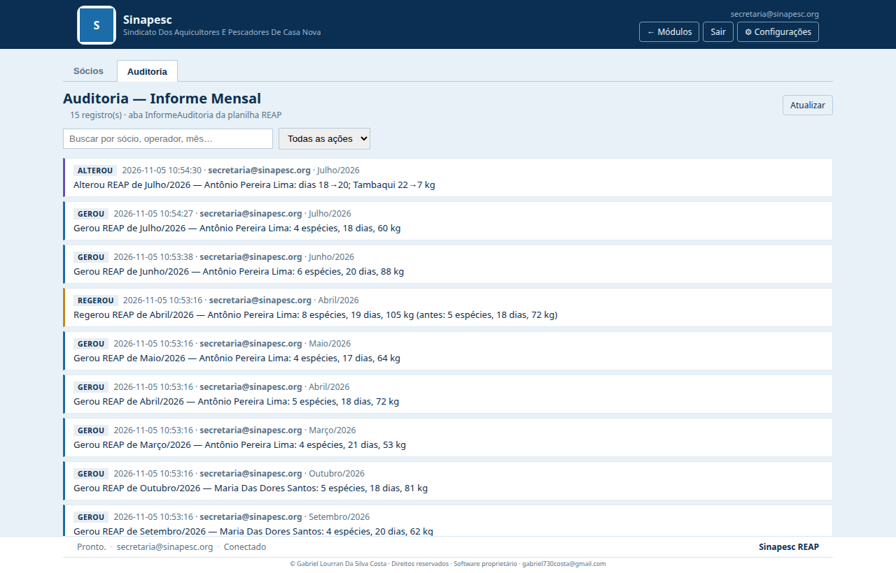

Aba **Auditoria** dentro do módulo, com busca e filtro por ação:

| Ação | Exemplo do texto |
|------|------------------|
| **Gerou** | Gerou REAP de Junho/2026 — Antônio Pereira Lima: 6 espécies, 20 dias, 88 kg |
| **Regerou** | Regerou REAP de Abril/2026 — …: 8 espécies, 19 dias, 105 kg (antes: 5 espécies, 18 dias, 72 kg) |
| **Alterou** | Alterou REAP de Julho/2026 — …: dias 18→20; Tambaqui 22→7 kg; +Piau 9 kg; −Pescada |
| **Excluiu** | Excluiu REAP de Outubro/2026 — … (5 espécies, 18 dias, 81 kg) |
| **Abriu tabela** | Abriu tabela HTML do Informe Mensal 2026 (N sócio(s)) — informe-mensal-2026-….html |

Cada registro guarda data/hora, **usuário logado**, ação, detalhe, sócio, ano e mês.

## 7. Onde os dados ficam (planilha REAP)

O módulo usa a **mesma planilha do REAP** (`spreadsheet_id` do `config.json`). As abas são criadas sozinhas no primeiro uso.

### 7.1 Aba `InformeMensal` — uma linha por sócio/ano/mês

| Coluna | Conteúdo |
|--------|----------|
| id | identificador da linha |
| personId | id do sócio na aba Pessoas |
| cpf, nome, telefone | dados do sócio |
| ano, mes | ex.: `2026`, `jun` |
| houvePesca | `SIM` |
| dias | 16–21 |
| nEspecies | 4 / 5 / 6 / 8 |
| especies | texto legível: `Pescada 20 kg R$ 19,00; …` |
| especiesJson | lista na ordem: `[{"nome","kg","valor"}]` |
| pesoMes, faturamentoMes | soma de kg e kg × preço (referência) |
| municipio, local, petrecho, ambiente | Casa Nova/Remanso, Rio, Emalhe, Água Doce |
| assinatura | impressão digital do mês (anti-repetição) |
| geradoEm, geradoPor | quem gerou e quando |
| atualizadoEm, atualizadoPor | última alteração |
| motor | `cerebro_reformulacao/v5-plano` (ou `+manual` após edição; linhas antigas ficam com `v4-mensal`) |
| planoContagens | plano do sócio para Mar → Out, ex.: `4-6-5-4-8-5-6-4` (coluna Y, nova na v1.8.1) |

### 7.2 Aba `InformeAuditoria`

`id | em | usuario | acao | detalhe | personId | nome | ano | meses` (mesmo formato da Auditoria dos outros módulos).

> A aba `Reap` (controle de meses marcados) **não** é alterada pelo Informe Mensal.

## 8. Arquivos do código

| Arquivo | Função |
|---------|--------|
| `sinapesc-desktop/controle/informe_mensal.py` | Cérebro mês a mês: regras, preços, sazonalidade, anti-repetição, validação, texto para o site |
| `sinapesc-desktop/controle/informe_mensal_relatorio.py` | HTML da tabela por sócio (abre no navegador) |
| `sinapesc-desktop/sheets/informe_mensal_service.py` | Leitura/gravação das abas `InformeMensal` e `InformeAuditoria` |
| `sinapesc-desktop/webapp/api.py` | `load_informe_mensal`, `gerar_informe_mes`, `salvar_informe_mes`, `excluir_informe_mes`, `abrir_informe_tabela`, `load_informe_auditoria` |
| `sinapesc-desktop/web/js/informe_mensal.js` | Tela do módulo (lista, caixa de meses, edição, auditoria) |
| `sinapesc-desktop/web/css/informe_mensal.css` | Visual (piracema em cinza, grade de meses) |
| `sinapesc-desktop/web/js/app.js` | Botão no hub, rota `informe_mensal`, cabeçalho ← Módulos |
| `sinapesc-desktop/build_exe.spec` | Inclui os módulos novos no EXE |
| `sinapesc-desktop/test_informe_mensal.py` | Testes do módulo |

## 9. Testes feitos

- 120 sócios simulados, cada um gerando os 8 meses em ordem aleatória: nenhuma regra quebrada, peso anual sempre entre 540 e 650 kg, 120 planos diferentes, vizinhos sempre com quantidades diferentes, no máximo 1 mês de 8.
- Probabilidades: cada mês soma 100%; a chance de ter um mês de 8 fica entre 30% e 40%; com Março salvo com 6, Abril nunca sai com 6.
- Padrões iguais: um sócio clonado é detectado (plano, kg e mês idêntico); sócios diferentes não geram alerta.
- Perfil: estável por CPF + ano e diferente entre pescadores.
- Regerar, bloqueio da piracema, validação da edição, gravação/exclusão na planilha (cliente falso) e auditoria.
- Fluxo completo da API: gerar 8 meses, regerar, editar, excluir, auditoria.
- Fluxo da tela em navegador: gerar, editar, salvar e conferir a auditoria (as capturas deste documento).

Rodar localmente:

```bash
cd sinapesc-desktop
python test_informe_mensal.py
```

## 10. Mudanças da v1.8.4

- Botão **Peixes do cérebro**: seleção universal dos peixes que entram no cérebro.


- Card **Tabela** ao lado de **Abrir** em cada sócio: HTML individual só com os meses preenchidos.

## 11. Mudanças da v1.8.2

- Botão **Abrir tabela no navegador**: HTML com tabela por sócio (Jan→Dez) e detalhe dos meses preenchidos; abre numa aba do navegador e registra na Auditoria.

## 12. Mudanças da v1.8.1

- **Plano de quantidades por sócio**, sorteado com probabilidade e gravado na planilha (coluna `planoContagens`). Acaba o padrão repetido do tipo `4,5,4,6,8,4,6,8`.
- **8 espécies só para ~35% dos sócios**, no máximo 1 mês, de preferência no meio da safra.
- **Anti-repetição:** a mesma quantidade nunca em meses vizinhos, e cada repetição no ano reduz a chance (×0,45). O plano não repete o de outro sócio.
- **Kg humanizados por pessoa:** preferência por espécie e ritmo do ano próprios de cada pescador.
- **Cálculo de probabilidade** na caixa do sócio.
- **Padrões iguais** entre sócios: faixa na lista, filtro, selo **=** e aviso ao gerar.
- Meses pendentes mostram a quantidade prevista.

## 13. Mudanças da v1.8.0

- Botão **Informe Mensal** ao lado de **Abrir REAP**.
- Lista de sócios com busca, filtros, ano e progresso Jan → Dez.
- Caixa por sócio com 12 meses; Jan/Fev/Nov/Dez em cinza — **ÉPOCA DE PIRACEMA**.
- Gerar / Regerar / Editar / Excluir / Copiar texto por mês, salvando na planilha REAP.
- Cérebro v4 adaptado para mês a mês, sem repetir espécies, kg, posições ou dias.
- Aba **Auditoria** do módulo.
